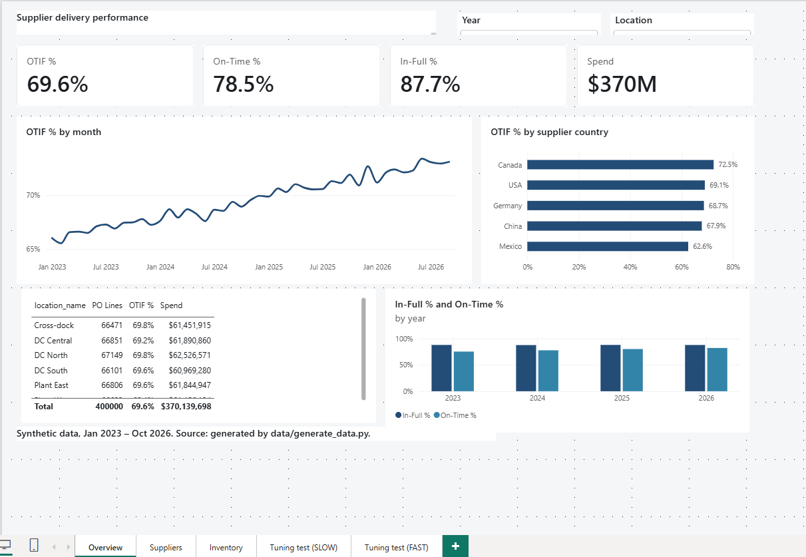
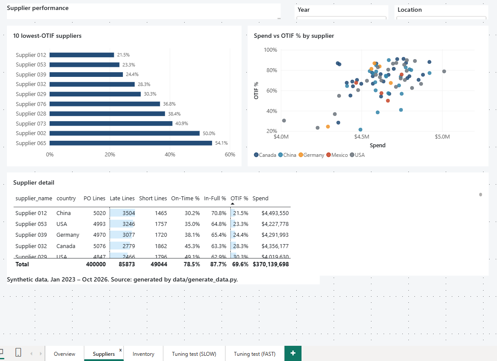
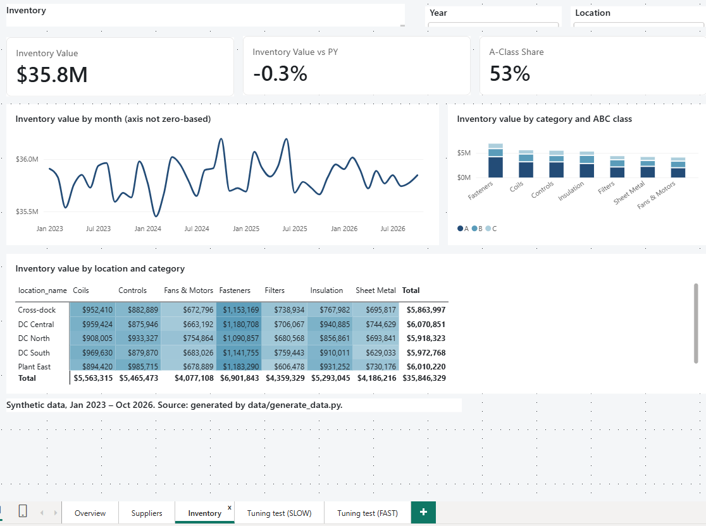

# Supply Chain Performance Dashboard (Power BI)

Portfolio project: a star-schema Power BI report on **synthetic** manufacturing/distribution data
(purchase orders, supplier delivery performance, inventory). Built to show dashboard design,
DAX/model performance tuning, and Git-based delivery.

> All data is generated by `data/generate_data.py`. No real company data is used.

## What's in the repo
| Path | Purpose |
|---|---|
| `data/generate_data.py` | Builds the star schema CSVs (weekly inventory snapshots, about 1.8M rows by default) |
| `theme/portfolio-theme.json` | Report theme (import via View > Themes > Browse for themes) |
| `dax/measures.dax` | Core measures plus SLOW (before) / FAST (after) variants |
| `docs/DESIGN_SPEC.md` | Page layout, grid, visual choices and why |
| `docs/TUNING_LOG.md` | Before/after performance measurements |
| `docs/CICD.md` | How changes are validated and promoted |
| `report/` | The `.pbip` project (report + semantic model as text files) |
| `.github/workflows/validate.yml` | CI checks on every push |

## Model
`dim_date`, `dim_product`, `dim_supplier`, `dim_location` -> `fact_po_lines`, `fact_inventory_daily`
(one-to-many, single direction, no bi-directional filters).

## Screenshots
| Overview | Suppliers | Inventory |
|---|---|---|
|  |  |  |

## What the report shows
- **Overview:** on-time, in-full and OTIF % for purchase orders, trended by month and split by supplier country, with a location summary.
- **Suppliers:** the 10 lowest-OTIF suppliers, spend vs OTIF % by supplier, and a detail table with late and short line counts.
- **Inventory:** latest-snapshot inventory value, change vs prior year, A-class share, and value by category, ABC class and location.

## Design decisions
- **Star schema:** four dimensions (date, product, supplier, location) and two facts (PO lines, weekly inventory snapshots), with single-direction one-to-many relationships and no bi-directional filters.
- **Semi-additive inventory:** inventory value takes the latest snapshot date in the filter context instead of summing every snapshot.
- **Design system:** one theme file, a consistent 8px grid, a restrained palette, sentence-case titles, alt text on every visual.
- **Synthetic data:** generated by `data/generate_data.py` with realistic supplier variation (a few chronic problem suppliers, a gradual improvement trend). No real company data is used.

## Performance tuning results
Measured in DAX Studio (Server Timings) against the 1.8M-row inventory snapshot and 400K PO lines. Full method and notes are in [docs/TUNING_LOG.md](docs/TUNING_LOG.md).

| Visual / measure | Before (ms) | After (ms) | What changed |
|---|---|---|---|
| Inventory value by category | 295 | 117 | Pre-computed `on_hand_value`; SUM with a date-column filter replaces SUMX + RELATED over FILTER |
| OTIF % by month | 13 | 3 | Boolean filters on pre-computed flags |
| Inventory value vs prior year | 35 | 32 | Variables and the fast base measure |

**Model size:** 20.56 MB -> 16.66 MB (-19%) after removing unused columns.

**Takeaways**
- One measure (inventory value) was the real bottleneck, and fixing it gave about a 60% reduction.
- The other two changes made little practical difference at this data size, so I don't claim them as wins.
- Pre-computing a value moves cost from query time to refresh time, and it must be rebuilt if unit costs change.

## Repository checks
A GitHub Actions workflow (`validate.yml`) runs on every push: it validates the theme file, confirms the required measures exist, blocks `.pbix` and cache files from being committed, and smoke-tests the data generator.

## Limitations
- Synthetic data, so the business findings are illustrative, not real.
- Performance timings are from one machine and one Power BI Desktop version; treat them as relative, not absolute.
- Deployment to the Power BI Service is manual; there is no automated release pipeline.

## Run it yourself
1. `pip install pandas numpy`, then `python data/generate_data.py`.
2. Open the `.pbip` in `report/` in Power BI Desktop. Go to Home > Transform data > Edit parameters,
   set `DataFolder` to the folder holding the generated CSVs (e.g. `C:\path\to\repo\data\out\`,
   with a trailing backslash), then Refresh.
3. Apply `theme/portfolio-theme.json` if it isn't already applied.